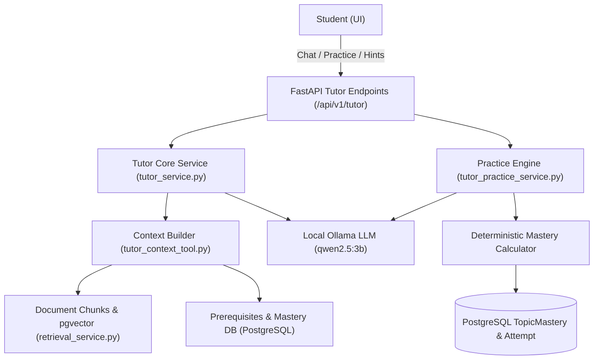
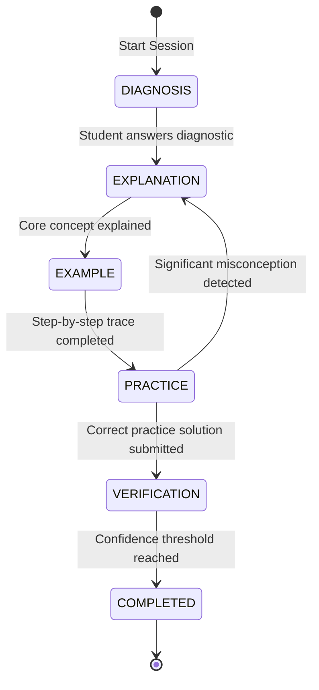

# Part 10: Personalized AI Tutor System

## 1. Overview & Objective

The **Personalized AI Tutor** is the intelligent 1-on-1 pedagogical engine of **CoursePilot AI**. Unlike generic LLM chat interfaces that merely provide passive text explanations or immediately reveal answers, CoursePilot AI Tutor acts as a rigorous academic tutor for Computer Science and Data Structures & Algorithms (DSA).

### Core Responsibilities
1. **Never stop at explaining**: Always verify whether the student genuinely understands.
2. **Context-Aware Grounding (RAG)**: Automatically retrieve course-specific chunks extracted from the student's uploaded syllabus and lecture notes (Part 5), citing exact unit and page locations (e.g., `Source: Unit 3, Page 12`).
3. **Prerequisite Intelligence**: Detect foundational prerequisite gaps (Part 8) before tackling advanced topics (e.g., identifying recursion deficits when teaching Dynamic Programming).
4. **Pedagogical State Machine**: Progressively guide the student through structured teaching stages:
   $$\text{DIAGNOSIS} \longrightarrow \text{EXPLANATION} \longrightarrow \text{EXAMPLE} \longrightarrow \text{PRACTICE} \longrightarrow \text{VERIFICATION} \longrightarrow \text{COMPLETED}$$
5. **Multi-Language & Depth Adaptability**: Support three language modes (`English`, `Hindi`, `Hinglish`) and three conceptual depths (`Beginner`, `Intermediate`, `Advanced`).
6. **Progressive Socratic Hints**: Provide up to 3 tiered hints without giving away the solution.
7. **Deterministic Mastery Updates**: Update student `TopicMastery` scores and confidence levels deterministically based on verified practice attempts, preventing artificial score inflation.
8. **Prompt Injection Defense**: Sanitize all untrusted reference text to neutralize adversarial jailbreaks.

---

## 2. Architecture & Data Flow

---

## 3. Database Schema

### `tutor_sessions`
| Column | Type | Description |
|---|---|---|
| `id` | `UUID` (PK) | Unique session identifier |
| `user_id` | `UUID` (FK) | Reference to `users.id` (cascade delete) |
| `course_id` | `UUID` (FK) | Reference to `courses.id` (cascade delete) |
| `topic_id` | `UUID` (FK) | Reference to `topics.id` (cascade delete) |
| `plan_item_id` | `UUID` (FK, Nullable) | Reference to `study_plan_items.id` (set null) |
| `language` | `VARCHAR(20)` | `english`, `hindi`, `hinglish` |
| `explanation_level` | `VARCHAR(20)` | `beginner`, `intermediate`, `advanced` |
| `status` | `VARCHAR(20)` | `active`, `completed`, `abandoned` |
| `current_stage` | `VARCHAR(30)` | `DIAGNOSIS`, `EXPLANATION`, `EXAMPLE`, `PRACTICE`, `VERIFICATION`, `COMPLETED` |
| `session_metadata` | `JSONB` | Teaching counters, hints used, consecutive scores, next action |
| `created_at` | `TIMESTAMP` | UTC session creation time |
| `updated_at` | `TIMESTAMP` | UTC last updated time |
| `completed_at` | `TIMESTAMP` (Nullable) | UTC completion timestamp |

### `tutor_messages`
| Column | Type | Description |
|---|---|---|
| `id` | `UUID` (PK) | Unique message identifier |
| `session_id` | `UUID` (FK) | Reference to `tutor_sessions.id` (cascade delete) |
| `role` | `VARCHAR(20)` | `user`, `assistant`, `system` |
| `content` | `TEXT` | Markdown-formatted dialogue content |
| `message_type` | `VARCHAR(30)` | `text`, `explanation`, `example`, `practice_question`, `hint`, `evaluation`, `system` |
| `related_topic_id` | `UUID` (FK, Nullable) | Topic reference if discussing a prerequisite |
| `sources` | `JSONB` | Array of `{ document_id, unit_name, page_number, snippet }` |
| `created_at` | `TIMESTAMP` | UTC timestamp |

### `attempts` Relationship
Each verified practice attempt created during tutoring links directly to `tutor_session_id`.

---

## 4. Teaching State Machine

1. **`DIAGNOSIS`**: The tutor tests the student's prerequisite grasp and baseline intuition before explaining.
2. **`EXPLANATION`**: The tutor breaks down the concept according to the student's chosen depth (`beginner`, `intermediate`, `advanced`) and language.
3. **`EXAMPLE`**: The tutor provides a concrete DSA code walkthrough in Java with an explicit trace table or dry run.
4. **`PRACTICE`**: The tutor generates a targeted problem, testing application without immediately giving answers.
5. **`VERIFICATION`**: The tutor assesses edge case awareness, time complexity understanding, and code adaptability.
6. **`COMPLETED`**: Once verified, the session concludes and reflects in the student's adaptive study plan.

---

## 5. Personalization Dimensions

### Explanation Levels
- **`beginner`**: Uses everyday physical analogies (e.g., call stack as a stack of cafeteria trays), step-by-step mental models, and explains every transition.
- **`intermediate`**: Standard university Computer Science rigour, Big-O time and space complexity, memory diagrams, and invariant logic.
- **`advanced`**: Formal mathematical induction, state space bounds, bitwise optimizations, and cache locality considerations.

### Languages
- **`english`**: Standard academic English.
- **`hindi`**: Clear Hindi technical instruction using Devanagari script.
- **`hinglish`**: Natural conversational bilingual blend commonly spoken by Indian CS engineering students (e.g., *"Jab base condition meet hoti hai, function call stack se pop ho jata hai"*).

---

## 6. Socratic Hint Discipline

When students struggle with practice problems, the tutor dispenses hints across 3 levels:
- **Level 1 (Guiding Question)**: Directs student attention to the problem's invariant without giving away logic (e.g., *"What condition determines when the recursion should terminate?"*).
- **Level 2 (Algorithmic Clue)**: Suggests a data structure or step without writing code (e.g., *"Consider how a two-pointer approach maintains window boundaries."*).
- **Level 3 (Concrete Step Clue)**: Gives a code snippet structure or base case check, but leaves the final logic to the student.

The final answer is **never** revealed on the first hint or before student submission.

---

## 7. Deterministic Topic Mastery Updates

Instead of relying on LLM score guessing, topic mastery is updated using a deterministic bounded recurrence relation:

### Correct Solution:
$$\text{new\_score} = \text{current\_score} + \left(\text{gain} \times (1.0 - \text{current\_score})\right)$$
Where:
- Hard question: $\text{gain} = 0.15$
- Medium question: $\text{gain} = 0.12$
- Easy question: $\text{gain} = 0.08$

### Incorrect Solution:
$$\text{new\_score} = \max\left(0.0, \, \text{current\_score} - \text{loss}\right)$$
Where:
- Hard question: $\text{loss} = 0.05$
- Medium question: $\text{loss} = 0.08$
- Easy question: $\text{loss} = 0.12$

### Confidence Score:
$$\text{confidence} = \min\left(1.0, \, \frac{n_{\text{attempts}}}{8.0}\right)$$

---

## 8. API Reference

| Method | Endpoint | Description |
|---|---|---|
| `POST` | `/api/v1/courses/{course_id}/tutor/sessions` | Start a new personalized tutor session |
| `GET` | `/api/v1/tutor/sessions/{session_id}` | Retrieve session state, stage, and recent dialogue |
| `POST` | `/api/v1/tutor/sessions/{session_id}/messages` | Send student message and advance dialogue |
| `GET` | `/api/v1/tutor/sessions/{session_id}/messages` | Retrieve full message history |
| `PATCH` | `/api/v1/tutor/sessions/{session_id}/preferences` | Update language and explanation depth dynamically |
| `POST` | `/api/v1/tutor/sessions/{session_id}/practice` | Generate a targeted practice problem |
| `POST` | `/api/v1/tutor/sessions/{session_id}/practice/{question_id}/submit` | Submit answer and receive structured evaluation |
| `POST` | `/api/v1/tutor/sessions/{session_id}/practice/{question_id}/hint` | Request progressive Socratic hints (1-3) |
| `POST` | `/api/v1/tutor/sessions/{session_id}/complete` | Finalize session and update study plan progress |

---

## 9. Verification & Test Suite Summary

- **Backend Tests**: **119 passing out of 119 tests** (100% pass rate in 17.71s across SQLite and PostgreSQL).
  - 16 dedicated tutor test cases in `test_tutor.py` verifying state transitions, RAG retrieval, citations, language modes, Socratic hints, anti-cheat answer shielding, prompt injection defense, and deterministic mastery updates.
- **Frontend Verification**: TypeScript compilation (`tsc -b`) and Vite production build (`npm run build --prefix frontend`) passing with 0 errors.

