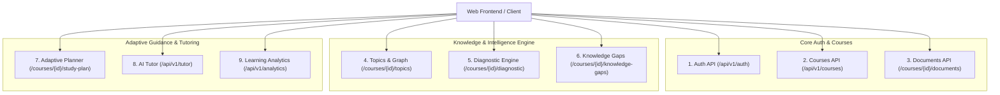

# CoursePilot AI — Complete API Integration Specification

> **Hackathon Track**: Homingo Hackathon 2026 — Track C3: *A Tutor for Every Learner*  
> **Promise**: *"An AI tutor that doesn't stop until you understand."*  
> **Backend Engine**: FastAPI 0.115+ / SQLAlchemy 2.0 / PostgreSQL with pgvector / Ollama  
> **Base URL Prefix**: `/api/v1`

---

## 1. Global Architectural Standards

### 1.1 Universal Response Envelope
All JSON responses strictly follow the CoursePilot AI standardized response envelope:

```json
{
  "success": true,
  "data": { ... },
  "message": "Human-readable operation status description"
}
```

Error responses utilize the same contract structure with `success: false` and standard HTTP status codes:
```json
{
  "success": false,
  "data": null,
  "message": "Detailed error message or validation summary"
}
```

### 1.2 Authentication & Authorization Headers
Protected endpoints require an RFC 6750 Bearer Token in the `Authorization` HTTP header:
```http
Authorization: Bearer <jwt_access_token>
```
Tokens are stateless HMAC-SHA256 JWTs containing `sub: <user_uuid>` and standard `exp` claims. Unauthorized requests return `401 Unauthorized`. Accessing resources belonging to other students returns `403 Forbidden` or `404 Not Found` (to prevent ID enumeration).

### 1.3 Data Types & Conventions
- **Identifiers**: All entities use RFC 4122 Version 4 UUID strings (`^[0-9a-f]{8}-[0-9a-f]{4}-4[0-9a-f]{3}-[89ab][0-9a-f]{3}-[0-9a-f]{12}$`).
- **Timestamps**: All timestamps are ISO 8601 UTC strings (`YYYY-MM-DDTHH:MM:SS.mmmmmmZ` or `+00:00`).
- **Dates**: Calendar dates use ISO 8601 `YYYY-MM-DD`.
- **Scores**: Normalized floating-point values between `0.0` and `1.0` (with percentage equivalents `0.0%` to `100.0%`).

---

## 2. API Domain Endpoint Groups



---

### Group 1: Authentication (`/api/v1/auth`)

#### `POST /api/v1/auth/register`
Creates a student account.
- **Request Body**:
  ```json
  {
    "email": "student@example.edu",
    "password": "StrongPassword123!",
    "full_name": "Jane Doe"
  }
  ```
- **Response** (`201 Created`):
  ```json
  {
    "success": true,
    "data": {
      "user": {
        "id": "e3e843bb-cbcf-40ea-94a3-76472b53e89c",
        "email": "student@example.edu",
        "full_name": "Jane Doe",
        "is_active": true,
        "created_at": "2026-11-22T12:00:00Z"
      },
      "token": {
        "access_token": "eyJhbGciOiJIUzI1Ni...",
        "token_type": "bearer",
        "expires_in": 86400
      }
    },
    "message": "User registered successfully"
  }
  ```

#### `POST /api/v1/auth/login`
Authenticates existing credentials.
- **Request Body**:
  ```json
  {
    "email": "student@example.edu",
    "password": "StrongPassword123!"
  }
  ```
- **Response** (`200 OK`): Token and user profile identical to registration payload.

#### `GET /api/v1/auth/me`
Fetches current authenticated profile.
- **Headers**: `Authorization: Bearer <token>`
- **Response** (`200 OK`): User object.

---

### Group 2: Course Management (`/api/v1/courses`)

#### `GET /api/v1/courses`
Lists all courses owned by authenticated user with optional `?search=` filter.

#### `POST /api/v1/courses`
Creates a course.
- **Request Body**:
  ```json
  {
    "title": "Data Structures & Algorithms",
    "course_code": "CS201",
    "description": "Fundamental algorithms, recursion, DP, and graphs.",
    "daily_study_time": 45,
    "target_exam_date": "2026-12-15"
  }
  ```
- **Response** (`201 Created`): Created Course object.

#### `GET /api/v1/courses/{course_id}`
Retrieves single course details with metadata and document count.

#### `PATCH /api/v1/courses/{course_id}`
Updates course parameters (`title`, `daily_study_time`, `target_exam_date`).

#### `DELETE /api/v1/courses/{course_id}`
Cascades deletion to documents, chunks, topics, prerequisites, attempts, and plans.

---

### Group 3: Document Management & PDF Processing (`/api/v1/courses/{course_id}/documents`)

#### `POST /api/v1/courses/{course_id}/documents/upload`
Uploads a syllabus or study material PDF.
- **Content-Type**: `multipart/form-data`
- **Form Fields**: `file: <binary_pdf_content>`
- **Validation**: Magic byte check `%PDF-`, $\le 20$ MB, $\le 200$ pages.
- **Processing**: Extracts text via PyMuPDF, chunks into 800-character windows (100 overlap), calculates 384-dimensional pgvector embeddings.
- **Response** (`202 Accepted` or `201 Created`):
  ```json
  {
    "success": true,
    "data": {
      "id": "7bca93b8-3642-4f05-b778-95843a859ea4",
      "course_id": "97e6beec-179c-4860-938a-367ea86d529a",
      "filename": "cs201_syllabus.pdf",
      "status": "COMPLETED",
      "total_pages": 14,
      "chunk_count": 48,
      "error_message": null,
      "created_at": "2026-11-22T12:05:00Z"
    },
    "message": "Document processed and indexed successfully"
  }
  ```

#### `GET /api/v1/courses/{course_id}/documents`
Lists all uploaded documents and processing states (`PENDING`, `PROCESSING`, `COMPLETED`, `FAILED`).

#### `POST /api/v1/courses/{course_id}/documents/{document_id}/retry`
Triggers synchronous/asynchronous reprocessing of a failed document.

#### `DELETE /api/v1/courses/{course_id}/documents/{document_id}`
Deletes document record, associated chunks, vector embeddings, and physical disk storage.

---

### Group 4: Topic Extraction & Knowledge Graph (`/api/v1/courses/{course_id}/topics`)

#### `POST /api/v1/courses/{course_id}/topics/extract`
Uses LLM + syllabus document chunks to construct curriculum hierarchy and Directed Acyclic Graph (DAG) of prerequisites.
- **Response** (`200 OK`):
  ```json
  {
    "success": true,
    "data": {
      "extracted_count": 14,
      "prerequisites_count": 13,
      "topics": [
        {
          "id": "c86f0270-e4b5-4148-8df0-761d7b387431",
          "name": "Recursion",
          "unit_name": "Unit 2: Recursive Thinking",
          "difficulty": "medium",
          "importance_score": 0.90,
          "estimated_minutes": 45,
          "prerequisites": ["Time Complexity"]
        }
      ]
    },
    "message": "Topics and prerequisite graph extracted successfully"
  }
  ```

#### `GET /api/v1/courses/{course_id}/topics`
Returns list of topics. Supports query parameter `?include_graph=true` to embed nodes and directed edges for ReactFlow graph visualizers.

---

### Group 5: Diagnostic Assessment Engine (`/api/v1/courses/{course_id}/diagnostic`)

#### `POST /api/v1/courses/{course_id}/diagnostic/start`
Initializes a multi-topic diagnostic evaluation session.
- **Request Body**:
  ```json
  {
    "topic_ids": ["c86f0270-e4b5-4148-8df0-761d7b387431", "90b2323a-f4e9-4dc8-a8ee-c5188f61feee"],
    "questions_per_topic": 3
  }
  ```
- **Response** (`201 Created`):
  Session ID and generated questions (`options`, `question`, `topic_id`). **Answers and explanations are strictly omitted** to preserve test integrity.

#### `POST /api/v1/courses/{course_id}/diagnostic/submit`
Submits student answers for deterministic grading.
- **Request Body**:
  ```json
  {
    "session_id": "893d9fc2-636c-482a-a9e9-1225574514ba",
    "answers": [
      {
        "question_id": "11111111-2222-3333-4444-555555555555",
        "selected_answer": "Option B (Correct)",
        "time_taken": 42
      }
    ]
  }
  ```
- **Response** (`200 OK`):
  Comprehensive evaluation with topic-by-topic accuracy, correctness flags, and mastery initializations.

#### `GET /api/v1/courses/{course_id}/diagnostic/sessions/{session_id}`
Fetches completed assessment scorecard with answer keys and conceptual explanations.

---

### Group 6: Knowledge Gap Analysis & Prerequisite Intelligence (`/api/v1/courses/{course_id}/knowledge-gaps`)

#### `POST /api/v1/courses/{course_id}/knowledge-gaps/analyze`
Executes bottleneck graph traversal: classifies topics (`weak`, `developing`, `strong`) and detects root prerequisite blockers.
- **Response** (`200 OK`):
  ```json
  {
    "success": true,
    "data": {
      "summary": {
        "weak_count": 2,
        "developing_count": 4,
        "strong_count": 8,
        "root_blockers_count": 1
      },
      "gaps": [
        {
          "topic_id": "a1b2c3d4-0000-0000-0000-000000000001",
          "topic_name": "DP State",
          "gap_type": "FOUNDATIONAL_BLOCKER",
          "severity": 0.85,
          "downstream_impact": ["Tabulation", "Grid DP"],
          "recommendation": "Review recursive state space and subproblem identification before attempting Tabulation."
        }
      ]
    },
    "message": "Knowledge gap analysis completed"
  }
  ```

#### `GET /api/v1/courses/{course_id}/knowledge-gaps/summary`
Returns cached latest analysis for rapid dashboard widget display.

---

### Group 7: Adaptive Learning Planner (`/api/v1/courses/{course_id}/study-plan`)

#### `POST /api/v1/courses/{course_id}/study-plan/generate`
Deterministic calendar scheduler: resolves prerequisite DAG topologically, applies weights (Gap Severity 30%, Prerequisite Impact 25%, Topic Difficulty 20%, Topic Importance 15%, Exam Urgency 10%), respects daily study time budgets, and schedules revision buffers.
- **Request Body**:
  ```json
  {
    "daily_minutes": 45,
    "exam_date": "2026-12-15",
    "force_regenerate": true
  }
  ```
- **Response** (`200 OK`):
  Multi-day schedule broken down by calendar date with prerequisite satisfaction status for every item.

#### `PATCH /api/v1/courses/{course_id}/study-plan/items/{item_id}/status`
Updates status of a study session (`PENDING`, `IN_PROGRESS`, `COMPLETED`, `SKIPPED`).

#### `POST /api/v1/courses/{course_id}/study-plan/replan`
Dynamically adjusts remaining schedule in response to newly acquired mastery or missed study sessions.

---

### Group 8: Personalized AI Tutor (`/api/v1/tutor`)

#### `POST /api/v1/tutor/sessions/start`
Starts a pedagogical tutoring dialogue anchored to a specific topic or study plan item.
- **Request Body**:
  ```json
  {
    "course_id": "97e6beec-179c-4860-938a-367ea86d529a",
    "topic_id": "a1b2c3d4-0000-0000-0000-000000000001",
    "plan_item_id": "55555555-4444-3333-2222-111111111111",
    "language": "hinglish",
    "explanation_level": "intermediate"
  }
  ```
- **Response** (`201 Created`): Active TutorSession object with greeting and pedagogical orientation.

#### `POST /api/v1/tutor/chat`
Sends student response, advances Socratic finite state machine (`DIAGNOSIS` $\rightarrow$ `EXPLANATION` $\rightarrow$ `PRACTICE` $\rightarrow$ `VERIFICATION` $\rightarrow$ `COMPLETED`).
- **Request Body**:
  ```json
  {
    "session_id": "66666666-7777-8888-9999-000000000000",
    "message": "Sir, DP State samajh nahi aa raha. Recursion se kaise relate karein?"
  }
  ```
- **Response** (`200 OK`):
  AI reply with citations to uploaded syllabus text chunks and progressive hints.

#### `POST /api/v1/tutor/verify`
Submits practice answer within tutor dialogue. When correct, triggers topic graduation and updates mastery.

---

### Group 9: Learning Analytics & Adaptive Progress (`/api/v1/analytics`)

#### `GET /api/v1/analytics/courses/{course_id}/overview`
Real-time honest student progress dashboard:
- Overall Mastery score (0–100%)
- Verified learning improvement percentage (derived solely from fresh non-repeated assessments)
- Consecutive study day streak
- Exam readiness score

#### `GET /api/v1/analytics/courses/{course_id}/velocity`
Longitudinal mastery trajectories and transition state counts (Weak $\rightarrow$ Developing $\rightarrow$ Strong).

#### `GET /api/v1/analytics/courses/{course_id}/improvement`
Detailed comparative audit of baseline diagnostic scores vs fresh post-tutoring performance. Duplicate questions are mathematically filtered out.

---

### Group 10: System Health & Diagnostics (`/api/v1/health`)

#### `GET /api/v1/health`
Deep probe verifying all core subsystem connections without leaking secrets.
- **Response** (`200 OK` when healthy/degraded, `503 Service Unavailable` when critical failure):
  ```json
  {
    "status": "healthy",
    "app": "CoursePilot AI API",
    "version": "1.0.0",
    "checks": {
      "database": {
        "status": "up",
        "latency_ms": 1.2
      },
      "vector_extension": {
        "status": "up",
        "pgvector_ready": true
      },
      "ollama": {
        "status": "up",
        "model": "llama3.2",
        "latency_ms": 14.5
      }
    }
  }
  ```

---

## 3. Error Handling Contract

| HTTP Status | Error Category | CoursePilot AI Handling Strategy |
|:---|:---|:---|
| `400 Bad Request` | Constraint Violation | Clean error explaining violated rule (e.g. invalid date range or invalid file signature). |
| `401 Unauthorized` | Missing / Invalid JWT | Redirects frontend to `/login` via Axios interceptor. |
| `403 Forbidden` | Multi-tenancy Isolation | Student cannot view or modify another student's courses or sessions. |
| `404 Not Found` | Entity Missing | Return clean 404 envelope without exposing internal stack traces. |
| `422 Unprocessable` | Schema Mismatch | Detailed Pydantic validation error mapping field paths to issues. |
| `500 Server Error` | Unhandled Exception | Internal logging with correlation ID; sanitized client message. |

