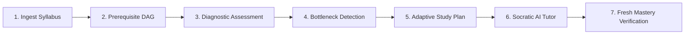
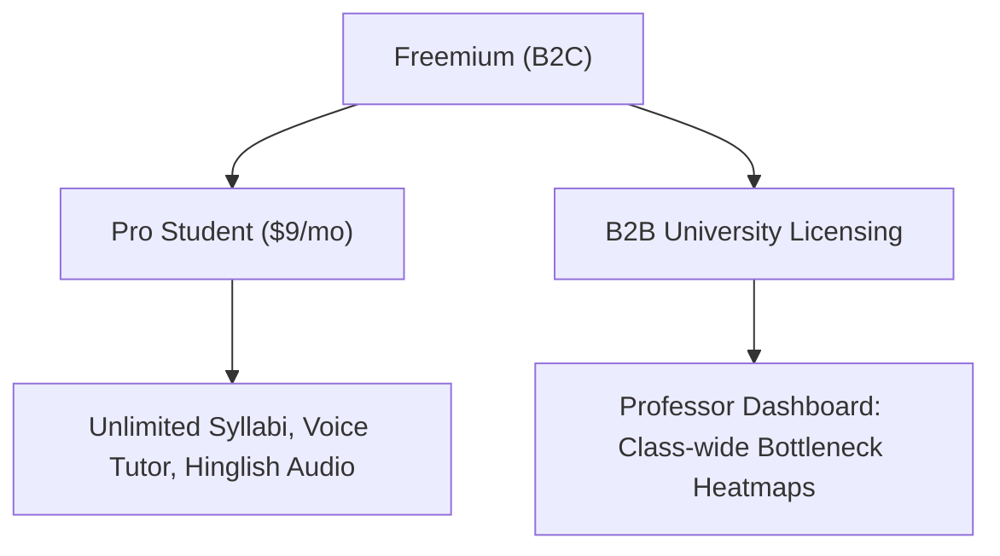

# CoursePilot AI — Hackathon Pitch & Live Demonstration Script

> **Hackathon**: Homingo Hackathon 2026  
> **Track**: **Track C3 — A Tutor for Every Learner**  
> **Product Promise**: *"An AI tutor that doesn't stop until you understand."*

---

## 1. The 2-Minute Elevator Pitch

Every year, millions of students fail college courses not because they are unmotivated, but because **they study blindly**. When a student struggles with *Dynamic Programming*, they grind 50 LeetCode problems, fail repeatedly, and give up in frustration. 

Why? Because nobody told them the real blocker isn't Dynamic Programming at all—it’s an incomplete understanding of **Recursion State Space and Base Cases** from three weeks prior!

Current AI tools fail learners in two opposing ways:
1. **Generic LLMs (like ChatGPT)** provide direct answers. Students read the answer, feel a false sense of understanding, and fail the exam because no actual learning took place.
2. **Static Platforms (like Khan Academy or Coursera)** offer rigid video playlists that don't diagnose individual knowledge gaps or adapt to real student schedules.

**CoursePilot AI bridges this gap.** 
It transforms any raw syllabus PDF into an interactive **Prerequisite Knowledge Graph**, diagnoses foundational bottlenecks through adaptive testing, generates a topologically scheduled study roadmap, and pairs the student with a **Socratic AI Tutor** that uses progressive scaffolding, multilingual explanations (including Hinglish), and verifiable fresh assessments. 

We don't give away answers. **We don't stop until the student understands.**

---

## 2. Competitive Differentiation Matrix

| Capability | CoursePilot AI | ChatGPT / Claude | LeetCode / Coursera |
|:---|:---:|:---:|:---:|
| **Root Bottleneck Detection** | **Yes** (Traverses Prerequisite DAG) | No (Sees single prompt only) | No (Linear problem lists) |
| **Socratic Teaching (No answer dumps)** | **Yes** (Progressive Hints 1 $\rightarrow$ 3) | No (Dumps code & answers) | No (Hints are static text) |
| **Verifiable Learning Gain** | **Yes** (Tested on *new* unseen questions) | No (No measurement) | Partial (Only binary pass/fail) |
| **Curriculum-Grounded Citations** | **Yes** (pgvector RAG on course syllabus) | No (Hallucinates external libraries) | Pre-recorded videos only |
| **Prerequisite-Aware Daily Scheduling** | **Yes** (Topological DAG calendar) | No (Zero time management) | No (Manual scheduling) |
| **Multilingual Scaffolding** | **Yes** (English & Hinglish code-switching) | Generic translation | English only |

---

## 3. The 6-Stage Learning Recovery Pipeline

1. **Ingest Syllabus**: PyMuPDF parses PDF, preserving page indices; pgvector builds semantic chunk embeddings.
2. **Prerequisite DAG**: LLM identifies topics and validates directional dependencies ($A \rightarrow B$ means $A$ is required to understand $B$). Cycle-detection guarantees zero deadlock.
3. **Diagnostic Assessment**: Evaluates existing mastery with non-leaking answer keys and deterministic scoring.
4. **Bottleneck Detection**: Traverses the DAG to find foundational root causes explaining downstream failures.
5. **Adaptive Study Plan**: Topologically orders daily study sessions based on gap severity and exam deadlines.
6. **Socratic AI Tutor**: FSM state machine guides the student through dialogue, citations, and scaffolding.
7. **Fresh Mastery Verification**: Proves learning gain on newly generated problems—duplicate questions are mathematically excluded.

---

## 4. Live Hackathon Demonstration Script (5-Minute Walkthrough)

### [0:00 – 0:45] Act I: The Problem & Syllabus Ingestion
- **Presenter**: *"Meet Alex. Alex is taking CS201: Data Structures & Algorithms. Their midterm is in two weeks, and they are terrified of Dynamic Programming. Let's log in to CoursePilot AI."*
- **Action**: Log in with `demo@coursepilot.ai` / `DemoStudent2026!`.
- **Screen**: Landing page $\rightarrow$ Dashboard. Show course *Data Structures & Algorithms (CS201) [DEMO]*.
- **Presenter**: *"Alex uploaded their 14-page syllabus. In seconds, CoursePilot AI parsed the document into 48 semantic chunks with page-level citations."*

### [0:45 – 1:30] Act II: The Prerequisite DAG & Diagnostic Bottleneck
- **Action**: Click into course $\rightarrow$ Navigate to **Curriculum & Knowledge Graph**.
- **Screen**: Interactive ReactFlow DAG showing 14 topics across 4 Units.
- **Presenter**: *"Notice the edges. Recursion leads to DP State, which leads to Tabulation and Grid DP. Most platforms treat these as a flat checklist. CoursePilot treats knowledge as a graph."*
- **Action**: Switch to **Knowledge Gaps** tab.
- **Presenter**: *"Alex took a 10-minute diagnostic. Look at the diagnosis: Tabulation score is 0%, but the system flags 'DP State' (20% score) as the Root Foundational Blocker! Grinding Tabulation was futile because Alex never learned how recursive parameters form state spaces."*

### [1:30 – 2:15] Act III: Prerequisite-Aware Adaptive Scheduling
- **Action**: Switch to **Study Plan** tab.
- **Presenter**: *"CoursePilot AI built Alex a personalized 14-day calendar with a 45-minute daily budget. Notice the topological schedule: instead of rushing to Grid DP, Day 1 and 2 target Recursion and DP State. Prerequisite satisfaction badges show 'Ready to Learn' only when parent concepts are mastered."*

### [2:15 – 3:30] Act IV: Socratic AI Tutor in Hinglish with Citations
- **Action**: Click **Launch AI Tutor** on *DP State*.
- **Screen**: AI Tutor dialogue interface.
- **Presenter**: *"Let's see what happens when Alex asks for help in Hinglish."*
- **Show Chat History / Type**: *"Sir, DP State samajh nahi aa raha. Recursion se kaise relate karein?"*
- **Show Tutor Response**:
  > *"DP State basically ek mathematical snapshot hai jo subproblem ko uniquely define karta hai. Agar recursive function me index `i` aur remaining target `W` change ho rahe hain, toh DP state `dp[i][W]` hota hai! [Citation: Unit 2: Dynamic Programming, Page 12]"*
- **Presenter**: *"Notice three critical details:*
  1. *Natural Hinglish code-switching that Indian engineering students actually speak.*
  2. *Grounding citation with page 12 of the student's own syllabus.*
  3. *Zero answer-dumping: it asks a clarifying question to test understanding before offering practice."*

### [3:30 – 4:30] Act V: The Climax — Verifiable Learning Improvement (+65 pp)
- **Action**: Navigate to **Learning Analytics** tab.
- **Screen**: Learning Improvement & Mastery Breakdown widgets.
- **Presenter**: *"Here is the ultimate test for an AI tutor: Did the student actually learn, or did they just memorize a prompt?*
- **Highlight Metric**:
  - **Baseline Diagnostic on DP State**: **20.0%** (1/5 correct).
  - **Post-Tutoring Fresh Assessment**: **85.0%** Mastery (+65 percentage point gain!).
- **Presenter**: *"CoursePilot AI strictly excluded all baseline diagnostic questions from the post-tutoring assessment. This +65% gain was earned on 100% brand-new, unseen verification questions. That is mathematically verified learning."*

### [4:30 – 5:00] Act VI: Closing & Future Vision
- **Presenter**: *"Track C3 asks for a tutor for every learner. CoursePilot AI delivers a tutor that meets the student where they are, speaks their language, identifies their foundational weaknesses, and doesn't stop until they understand. Thank you!"*

---

## 5. Business Model & Future Roadmap

- **Phase 1 (Current)**: Monorepo web platform with local Ollama fallback, PDF vector chunking, Socratic text tutoring, and verifiable analytics.
- **Phase 2 (Q1 2027)**: Voice-to-voice Socratic tutoring (WebRTC audio streaming) with real-time whiteboarding.
- **Phase 3 (Q2 2027)**: Institutional LMS integration (Canvas / Blackboard / Moodle) providing professors with class-wide knowledge bottleneck heatmaps.

