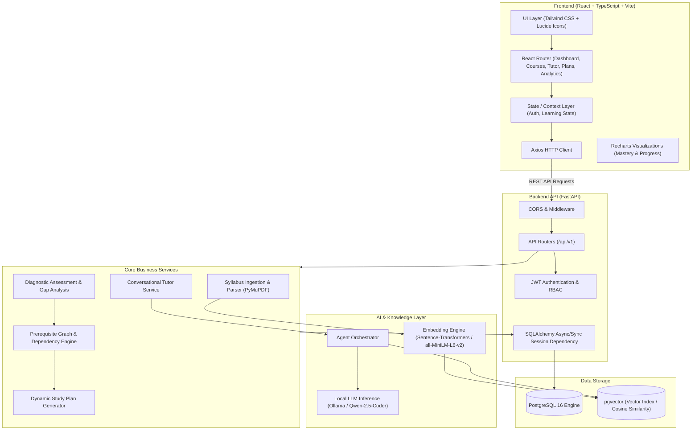

# CoursePilot AI — Architecture Specification

## 1. System Overview

**CoursePilot AI** is an AI-powered personalized learning recovery platform designed to bridge knowledge gaps for computer science students. Initially targeting Data Structures & Algorithms (DSA), the system:
1. Ingests and parses academic course syllabi and lecture materials (PDFs).
2. Extracts hierarchical topics and prerequisite dependency graphs.
3. Conducts adaptive diagnostic assessments to pinpoint missing prerequisites and weak concepts.
4. Generates dynamic, milestone-driven recovery study plans.
5. Provides an interactive, context-grounded AI Tutor via Retrieval-Augmented Generation (RAG).
6. Continuously tracks student mastery and adapts learning recommendations.

---

## 2. High-Level Architecture Diagram

---

## 3. Technology Stack Breakdown

| Tier | Technology | Purpose |
| :--- | :--- | :--- |
| **Frontend Framework** | React 19 + TypeScript | Type-safe, component-driven client user interface |
| **Build & Tooling** | Vite | Instant HMR, fast production bundling |
| **Styling** | Tailwind CSS | Utility-first responsive design system |
| **Navigation** | React Router v7 | Client-side routing and layout management |
| **Visualizations** | Recharts | Mastery radar charts, progress bar charts, and timeline graphs |
| **HTTP Client** | Axios | Configured client with request/response interceptors |
| **Backend Framework** | FastAPI | High-performance asynchronous Python REST API |
| **ORM / Database Access**| SQLAlchemy 2.0 | Declarative models, query building, connection pooling |
| **Data Validation** | Pydantic v2 + Pydantic Settings | Strict schema validation and environment configuration |
| **Database** | PostgreSQL 16 + pgvector | Relational schema with native vector similarity operations |
| **LLM Runtime** | Ollama (Qwen 2.5 Instruct) | Local, privacy-conscious model inference for reasoning & tutoring |
| **Embeddings** | Sentence-Transformers | Dense vector representations for syllabus and document chunks |
| **PDF Extraction** | PyMuPDF (fitz) | Fast, structured syllabus and slide text extraction |

---

## 4. Module Responsibilities

### 4.1 Frontend (`frontend/src/`)
- `components/common/`: Reusable primitives (Buttons, Modals, Cards, Navbars).
- `components/dashboard/`: Overview widgets, quick actions, current progress summary.
- `components/course/`: Syllabus upload, module breakdown, and topic listings.
- `components/quiz/`: Interactive diagnostic assessment interface and scoring feedback.
- `components/tutor/`: Real-time chat interface with source citations and code rendering.
- `components/roadmap/`: Visual graph rendering for prerequisite pathways and study plans.
- `pages/`: Route container pages (`DashboardPage`, `CoursesPage`, `TutorPage`, `StudyPlanPage`, `AnalyticsPage`).
- `services/`: API interaction modules wrapping Axios.

### 4.2 Backend (`backend/app/`)
- `api/routes/`: Route controllers partitioned by domain (`health`, `auth`, `courses`, `assessments`, `tutor`, `plans`).
- `core/`: Application settings, database session creation, security utilities (password hashing, JWT).
- `models/`: SQLAlchemy ORM entity definitions.
- `schemas/`: Pydantic request/response validation schemas.
- `services/`: Isolated business logic and domain processing.
- `agents/`: AI agent orchestration, prompt templates, and agent tool execution.
- `ai/`: Embeddings generation, vector index queries, and LLM client wrappers.

---

## 5. Prerequisite & Recovery Pipeline

1. **Extraction**: The student uploads a course syllabus PDF. PyMuPDF extracts sections, which the LLM structures into topics and prerequisite links.
2. **Graph Construction**: Topics are indexed as a Directed Acyclic Graph (DAG) of prerequisites.
3. **Diagnostic Assessment**: Questions targeted at foundational prerequisites evaluate the student's mastery score ($0.0 \le \text{mastery} \le 1.0$).
4. **Gap Identification**: Topological analysis discovers unfulfilled predecessor topics where mastery is below the threshold ($< 0.7$).
5. **Study Plan Synthesis**: A customized learning trajectory is generated prioritizing foundational gaps before advanced topics.
6. **RAG Tutoring**: When questions arise, pgvector finds top-$k$ relevant chunks from the syllabus and lecture notes to augment LLM answers with grounded context.

